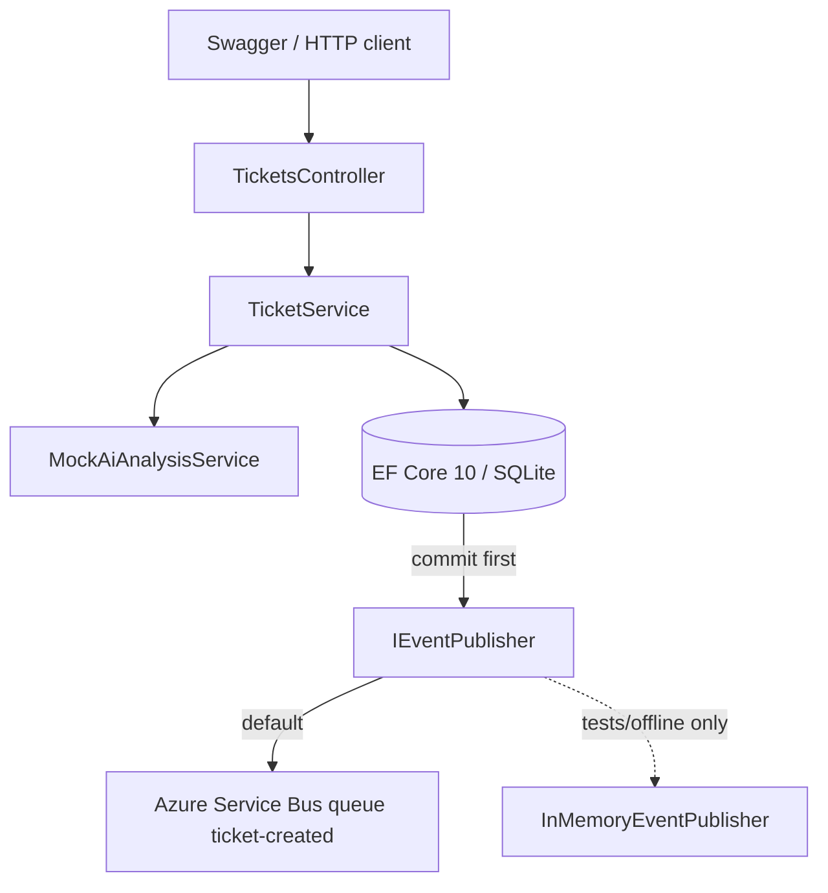

# Support Ticket Intake & AI Triage API

Version 2.0 implementation of a .NET 10 REST API that accepts support tickets, classifies them with a deterministic mock, persists them to SQLite, and publishes a `TicketCreated` event. **Azure Service Bus is the default publisher.** In-memory publishing is only for automated tests and explicit offline runs.

Companion documents: [docs/SPEC.md](docs/SPEC.md), [docs/PLAN.md](docs/PLAN.md), [docs/AZURE.md](docs/AZURE.md).

## Architecture

Single ASP.NET Core 10 API with pragmatic Clean Architecture:

```text
SupportTicketTriage/
├── src/
│   ├── SupportTicketTriage.Api/             # Controllers, ProblemDetails, composition root
│   ├── SupportTicketTriage.Application/     # TicketService, DTOs, persistence/AI/event contracts
│   ├── SupportTicketTriage.Domain/          # Ticket, TicketAnalysis, TicketCreatedEvent
│   └── SupportTicketTriage.Infrastructure/  # EF Core/SQLite, mock AI, Service Bus, in-memory
├── tests/SupportTicketTriage.Tests/         # Azure-free unit + HTTP integration tests
├── docs/
├── scripts/live-service-bus-smoke.ps1
└── evidence/
```



**Locked decisions**

1. Azure Service Bus queue `ticket-created` is the default publisher and is mandatory for cloud acceptance.
2. SQLite stores UTC `DateTime` values (not `DateTimeOffset`).
3. Deterministic mock AI is the only AI implementation.
4. Publish happens after SQLite commit. There is no transactional outbox.
5. `dotnet test` never requires Azure. The test host forces `InMemory`. Live smoke verification is a separate gate.

## Prerequisites

- .NET 10 SDK
- For the default Service Bus publisher: Azure subscription, namespace, queue `ticket-created`, and either a Send connection string in user secrets (`AzureServiceBus:ConnectionString`) or Azure CLI (`az login`) plus **Azure Service Bus Data Sender**. Peeking in Portal Explorer needs Data Receiver / Explorer access.

Live send to `ticket-created` on `sb-supportticket-triage-dev` was verified on 2026-11-05. See [evidence/SERVICE_BUS_SMOKE.md](evidence/SERVICE_BUS_SMOKE.md).

## Local run

```bash
dotnet restore SupportTicketTriage.slnx
dotnet build SupportTicketTriage.slnx
dotnet run --project src/SupportTicketTriage.Api
```

Open Swagger at `http://localhost:5079/swagger` (or the HTTPS launch profile). The default publisher is Azure Service Bus queue `ticket-created` on `sb-supportticket-triage-dev`. Put the Send connection string in user secrets (`AzureServiceBus:ConnectionString`); do not commit it. Offline runs that must not call Azure can still set `EventPublishing__Provider=InMemory`.

```json
{
  "EventPublishing": { "Provider": "AzureServiceBus" },
  "ConnectionStrings": { "Default": "Data Source=support-tickets.db" },
  "AzureServiceBus": {
    "FullyQualifiedNamespace": "sb-supportticket-triage-dev.servicebus.windows.net",
    "QueueName": "ticket-created"
  }
}
```

Startup applies the tracked EF Core migration. SQLite files are gitignored.

### Endpoints

| Method | Route | Notes |
|---|---|---|
| POST | `/api/tickets` | Validate → classify → save Ticket + TicketAnalysis → publish → `201` + `Location` |
| GET | `/api/tickets/{id}` | `200` with analysis, `404` if missing, `400` if the id is not a GUID |
| GET | `/api/tickets` | `pageNumber`, `pageSize` (1–100), `priority`, `sortOrder` (`asc`/`desc`). Filter/sort/page in SQLite |

Example create body:

```json
{
  "customerName": "John Smith",
  "email": "john@example.com",
  "description": "Our production application is down and users cannot log in. Urgent help needed."
}
```

## Azure Service Bus (default)

`appsettings.json`, Development settings, and the `http`/`https` launch profiles all select `AzureServiceBus`. A missing `EventPublishing:Provider` also selects Azure Service Bus. Do not claim a demo passed on InMemory.

The default connection values are:

```text
EventPublishing__Provider=AzureServiceBus
AzureServiceBus__FullyQualifiedNamespace=sb-supportticket-triage-dev.servicebus.windows.net
AzureServiceBus__QueueName=ticket-created
AzureServiceBus__ConnectionString=<shared access connection string with Send>
```

`AzureServiceBus__ConnectionString` sends without `az login`. Keep it in user secrets or an environment variable. If that value is empty, the API uses `DefaultAzureCredential` and needs `az login` plus **Azure Service Bus Data Sender**, with `AzureServiceBus__FullyQualifiedNamespace` set. Start the API, POST a unique non-sensitive ticket, and **peek** (do not receive-and-delete) the `ticket-created` queue. Expected message metadata:

| Property | Value |
|---|---|
| `MessageId` | event `eventId` (stable for that send) |
| `Subject` | `TicketCreated` |
| `ContentType` | `application/json` |
| `CorrelationId` | request correlation id |
| `ApplicationProperties["schemaVersion"]` | `1.0` |

The JSON body contains `eventId`, `eventType`, `schemaVersion`, `correlationId`, `occurredAtUtc`, and `data.ticketId/category/priority` only. It must not contain name, email, or description.

If `Provider=AzureServiceBus` and both the connection string and the namespace are missing, or the queue name is missing, the host fails. It does **not** fall back to InMemory.

Provisioning steps: [docs/AZURE.md](docs/AZURE.md). Smoke runbook: [scripts/live-service-bus-smoke.ps1](scripts/live-service-bus-smoke.ps1).

## Failure and delivery guarantees

| Failure | Ticket saved? | Broker confirmed? | HTTP |
|---|---|---|---|
| Validation | No | No | 400 ProblemDetails |
| AI / unexpected | No | No | 500 ProblemDetails |
| Database save | No | No | 500 ProblemDetails |
| Broker accepted | Yes | Yes | 201 |
| Broker error after commit | Yes | No / uncertain | 503 ProblemDetails |

SQLite and Service Bus are not in one transaction. A send timeout can mean the broker already accepted the message. Retrying POST creates a **new** ticket and a new event. Duplicate detection (optional, Standard tier) only deduplicates the same `MessageId` inside its window. There is no idempotent POST API and no outbox in v2.0.

## Mock AI

`MockAiAnalysisService` is offline and deterministic. Category precedence: Billing → Technical → Account → General. Priority precedence: Critical → High → Medium → Low. Category and priority are independent. The summary is a normalized/truncated extract, not a generated narrative.

| Description | Category | Priority |
|---|---|---|
| Payment charged twice | Billing | Medium |
| Production application down | Technical | Critical |
| Cannot reset password | Account | Medium |
| General product question | General | Low |
| Urgent widespread billing failure | Billing | High |

## Tests

```bash
dotnet test SupportTicketTriage.slnx
```

The suite uses isolated SQLite and a fake publisher. It must pass without Azure credentials, network, or RBAC. Live Service Bus checks are **not** in this suite.

Verified locally during this implementation: **32/32 passed**, Azure-free.

## Assumptions and limits

- Field lengths follow SPEC §3.4 (not specified in the original client PDF).
- Correlation IDs are accepted only when `X-Correlation-ID` is a GUID; otherwise a new GUID is generated.
- Swagger UI is enabled in Development/Demo only.
- No consumer, Functions, topics, outbox, SQL Server, or live Azure OpenAI.
- Transitive NuGet advisories from EF Core Design/SQLite (`SQLitePCLRaw`, design-time crypto packages) remain on the 10.0.0 package line. `Microsoft.OpenApi` was raised to 2.7.5 to address GHSA-v5pm-xwqc-g5wc.

## AI Usage Notes

Built with Cursor Agent against SPEC/PLAN v2.0. Prompts followed the phase prompts in PLAN.md. The following are real review outcomes from this session, not invented examples.

1. **Rejected a fake Azure send.** Azure CLI was not installed and no namespace was available. The agent documented EV02 as **BLOCKED** instead of treating the in-memory publisher or unit-test message mapping as cloud proof.
2. **Rejected `DateTimeOffset` and a Kind-converting store expression.** SPEC requires UTC `DateTime` and SQLite-side `ORDER BY`. A method-group value converter failed to compile; a `ToUniversalTime()` convert-to-provider expression was dropped so ordering stays a column sort. Kind is restored on materialization.
3. **Corrected shared SQLite in HTTP tests.** The first `WebApplicationFactory` setup reused the default `support-tickets.db` and one factory across parallel xUnit tests, so ticket counts were 4–12 instead of 1. Each test now gets a replaced `ApplicationDbContext` on a unique temp file.
4. **Rejected `StatusCodes.Status499ClientClosedRequest`.** That constant is not part of ASP.NET Core here. Cancellation is left unhandled by the exception mapper rather than inventing a status code.

EV02 was later completed: a real `TicketCreated` message was published and seen in the `ticket-created` queue. Sanitized details are in [evidence/SERVICE_BUS_SMOKE.md](evidence/SERVICE_BUS_SMOKE.md).
