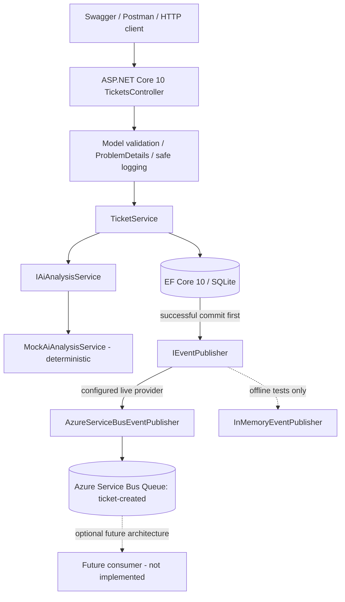

# Support Ticket Intake & AI Triage API — Technical Specification

**Version:** 2.0  
**Status:** Approved implementation baseline  
**Date:** 2026-11-04  
**Basis:** Client's *Senior Software Developer — Technical Assessment (AI-Assisted Build, 1-Day)*, with a **project-mandated Azure Service Bus extension**.  
**Companion:** [PLAN.md](PLAN.md)  
**Deliverable:** Git repository or ZIP with API, migrations, tests, README, and evidence of a real Service Bus send.

## 1. Objective and requirement provenance

Create a small REST API to receive support tickets, validate and persist them, classify them using a deterministic AI-service mock, return tickets and paginated search results, and publish a `TicketCreated` event **to a real Azure Service Bus queue** after successful database persistence.

**Client PDF requirements:** .NET 10, EF Core, SQLite or LocalDB, `IAiAnalysisService` (mock acceptable), `IEventPublisher` (in-memory sufficient in the original brief), xUnit, Swagger/OpenAPI, 3 endpoints, global error handling, safe structured logs, and README with honest AI usage notes. Original exercise suggests approximately **6–8 focused hours**.

**Version 2.0 project decision:** Azure Service Bus is **mandatory for our delivery and final acceptance**, even though it is described as an *optional bonus* in the original client PDF. Do not claim that the client PDF itself mandates Service Bus. A local in-memory test implementation remains permitted, but **does not satisfy final cloud acceptance**.

### 1.1 Fixed architectural decisions (non-negotiable for v2.0)

1. **Azure Service Bus Queue is mandatory**: publish a real `TicketCreated` message and verify it in Azure.
2. **SQLite persists the data** through EF Core 10. Persist UTC timestamps as `DateTime` (UTC) to support provider-side ordering.
3. **Deterministic Mock AI is the only required AI implementation** and the default. Live Azure OpenAI is out of scope.
4. **Direct publish after DB commit**: no transactional outbox. Explain DB/broker inconsistency and possible duplicate creation/message outcomes.
5. **Automated tests have zero Azure dependency**. A separate manual/scripted **live Service Bus smoke test is mandatory** for final acceptance.

### 1.2 In scope

- `POST /api/tickets`: validate → classify → save Ticket + TicketAnalysis atomically within SQLite → publish `TicketCreated` through `IEventPublisher` → return `201 Created` only after broker acknowledgement.
- `GET /api/tickets/{id}`: ticket with analysis, `404` when not found.
- `GET /api/tickets`: pagination, creation-date sort, priority filtering.
- Provider-driven configuration for `AzureServiceBus` and `InMemory`; deploy/demo configuration must select Azure Service Bus. Offline use of InMemory is for development/tests only.
- EF Core migration, structured logging, ProblemDetails, xUnit unit + HTTP integration tests, OpenAPI + interactive Swagger UI, README/AI Usage Notes.
- Azure provisioning instructions, role assignment requirements, live cloud verification and evidence checklist.

### 1.3 Out of scope

Frontend, external identity/user auth, SQL Server, live Azure OpenAI, Service Bus consumer/processor, Azure Functions, topic/subscriptions, transactional outbox, broker provisioning by application startup, IaC pipeline, microservices, CQRS/MediatR, notifications, enterprise observability deployment. Do not silently introduce these components.

## 2. Architectural overview

**Style:** single deployable ASP.NET Core 10 API, pragmatic Clean Architecture separation in four projects plus a test project. Controllers are thin; orchestration resides in `TicketService`.



**Ordering note:** The DB-to-publisher arrow expresses operation sequencing, not direct coupling; `TicketService` performs both calls. The broker and DB do not share a transaction.

### 2.1 Project structure and references

```text
SupportTicketTriage/
├── src/
│   ├── SupportTicketTriage.Api/             # Controller, contracts, composition root, HTTP errors
│   ├── SupportTicketTriage.Application/     # TicketService, DTOs, service/persistence interfaces
│   ├── SupportTicketTriage.Domain/          # Ticket, TicketAnalysis, TicketCreatedEvent
│   └── SupportTicketTriage.Infrastructure/  # EF Core, migrations, mock AI, Service Bus, in-memory
├── tests/
│   └── SupportTicketTriage.Tests/           # Unit + HTTP integration tests, Azure-free
├── docs/
│   ├── SPEC.md
│   └── PLAN.md
└── README.md
```

Dependencies: `Api → Application + Infrastructure` (composition root), `Application → Domain`, `Infrastructure → Application + Domain`, `Domain → none`. Define a focused `IApplicationDbContext` contract (or equivalent narrow persistence abstraction) within Application; implemented by Infrastructure. Avoid generic repositories without a real need. Do not reference Infrastructure from Application.

### 2.2 Component selection

| Concern | Choice | Justification |
|---|---|---|
| REST | ASP.NET Core 10 controller API | Required and familiar |
| Data | EF Core 10 + SQLite | Reproducible local database |
| AI | `IAiAnalysisService` + deterministic mock | Offline and repeatable |
| Broker | Azure Service Bus **Queue** `ticket-created` | Mandatory cloud publishing; no consumer needed |
| Azure SDK | `Azure.Messaging.ServiceBus` | Supported queue sender abstraction |
| Auth | `Azure.Identity` `DefaultAzureCredential` | No checked-in secrets; needs Data Sender role |
| Local event test double | InMemory publisher | Automated tests avoid Azure |
| Errors | `IExceptionHandler` + ProblemDetails | Consistent HTTP JSON |
| Tests | xUnit + `WebApplicationFactory` + isolated SQLite | Real API pipeline, cloud-free |
| Docs | ASP.NET Core OpenAPI + compatible Swagger UI | Interactive API demo |

## 3. HTTP API contract

### 3.1 POST `/api/tickets`

Request:

```json
{
  "customerName": "John Smith",
  "email": "john@example.com",
  "description": "Our production application is down and users cannot log in. Urgent help needed."
}
```

Processing and guarantees:

1. Validate and normalize input. Invalid input: `400`, no AI call, no DB write, no event.
2. Call `IAiAnalysisService.AnalyseAsync` and validate returned category, priority, and nonempty summary.
3. Build `Ticket`, `TicketAnalysis` and a stable `TicketCreatedEvent` using one ticket identity and UTC timestamps.
4. Use one EF Core `SaveChangesAsync` for Ticket + TicketAnalysis; commit before publishing. A default single `SaveChangesAsync` provides a relational transaction for its changes.
5. Invoke `IEventPublisher.PublishAsync` exactly once in application orchestration after successful save. The Azure SDK may retry transient send attempts internally; this does not guarantee exactly-once delivery.
6. After successful broker acknowledgment, respond `201 Created`, `Location: /api/tickets/{id}`, ticket with analysis.

Illustrative `201` response:

```json
{
  "id": "b6213028-f8f7-4d3b-8554-160343be52da",
  "customerName": "John Smith",
  "email": "john@example.com",
  "description": "Our production application is down and users cannot log in. Urgent help needed.",
  "createdDate": "2026-11-04T12:00:00Z",
  "analysis": {
    "category": "Technical",
    "priority": "Critical",
    "summary": "Our production application is down and users cannot log in. Urgent help needed.",
    "analysedDate": "2026-11-04T12:00:00Z"
  }
}
```

The mock summary is a normalized/truncated extract, not a generative statement. Actual timestamps/IDs vary.

**Failure contract:** If send fails or cannot be confirmed *after* DB commit, respond `503 Service Unavailable` with generic ProblemDetails (no success claim); the database ticket **remains saved**, and the broker outcome may be unknown. Log `TicketId`, `EventId`, exception category, and correlation ID, but do not expose details to callers. A retry of the entire POST can create another ticket and event. No idempotent POST API or outbox is implemented in v2.0; explicitly document this risk. For permanent misconfiguration/auth errors, deployment smoke test must fail; do not claim such errors are transient.

### 3.2 GET `/api/tickets/{id}`

- `200` includes ticket and nested analysis.
- `404` with ProblemDetails if unknown valid GUID.
- Invalid GUID returns `400` using model binding (do not add `:guid` route constraint if using this contract).
- Read queries use `AsNoTracking()`.

### 3.3 GET `/api/tickets`

Example: `GET /api/tickets?pageNumber=1&pageSize=10&priority=High&sortOrder=desc`.

| Parameter | Default | Allowed values |
|---|---|---|
| `pageNumber` | `1` | integer ≥ 1 |
| `pageSize` | `10` | integer 1–100 |
| `priority` | none | `Low`, `Medium`, `High`, `Critical` (case-insensitive) |
| `sortOrder` | `desc` | `asc` or `desc` |

Apply priority filtering, `CreatedDate` ordering, secondary `Id` ordering, `Skip`/`Take`, and `CountAsync` **in SQLite through EF Core**. Return `{items,pageNumber,pageSize,totalCount,totalPages}`; empty page is `200`.

### 3.4 Validation and error shape

Assessment assumptions (limits are not specified by the client): `CustomerName` required trimmed length 1–200; `Email` required syntactically valid max 254; `Description` required trimmed length 10–5000. Reject whitespace-only and invalid query parameters. Use ProblemDetails for `400`, `404`, `500`, `503`; no stack traces, secrets or sensitive data in HTTP errors. `500` covers AI/persistence/unexpected failures; broker send failure maps to `503` when identified.

## 4. Database schema and UTC strategy

**Use .NET `DateTime` with `DateTimeKind.Utc` for both stored timestamp properties.** This is an explicit v2.0 decision, replacing the v1.0 `DateTimeOffset` ambiguity. SQLite supports reliable database-side sort/filter of this EF Core-mapped value. Set values through a UTC clock at creation; read/serialize consistently as UTC ISO-8601 with `Z`. Be aware SQLite does not retain `DateTime.Kind`; enforce UTC in the persistence boundary/DTO mapping or via a tested EF value converter. Never infer local time from an unspecified DB value.

| Entity | Property | Type / constraint |
|---|---|---|
| Ticket | `Id` | Guid, PK, application-generated |
| Ticket | `CustomerName` | string, required, max 200 |
| Ticket | `Email` | string, required, max 254 |
| Ticket | `Description` | string, required, max 5000 |
| Ticket | `CreatedDate` | `DateTime` UTC, indexed |
| TicketAnalysis | `TicketId` | Guid, PK and FK to Ticket |
| TicketAnalysis | `Category` | string, required |
| TicketAnalysis | `Priority` | string, required; indexed if useful |
| TicketAnalysis | `Summary` | string, required; reasonable max |
| TicketAnalysis | `AnalysedDate` | `DateTime` UTC |

Relationship: Ticket 1 → 0..1 TicketAnalysis in ORM, but every successful POST creates exactly one analysis. Migration files are tracked. Use no client-side sorting.

## 5. AI analysis (mock default)

```csharp
public sealed record AiAnalysisResult(string Category, string Priority, string Summary);
public interface IAiAnalysisService
{
    Task<AiAnalysisResult> AnalyseAsync(string description, CancellationToken cancellationToken = default);
}
```

`MockAiAnalysisService` is deterministic, offline, case-insensitive, whitespace-normalizing, with documented keyword precedence and bounded summary. Categories: `Billing`, `Technical`, `Account`, `General`; priorities: `Low`, `Medium`, `High`, `Critical`. Priority and category are evaluated independently. Proposed test vectors:

| Description intent | Expected category | Expected priority |
|---|---|---|
| Payment charged twice | Billing | Medium |
| Production application down | Technical | Critical |
| Cannot reset password | Account | Medium |
| General product question | General | Low |
| Urgent widespread billing failure | Billing | High |

Formalize keyword lists and precedence in code and cover them with unit tests. Summary should be normalized/truncated source content, not an invented LLM summary. Live Azure OpenAI implementation is not required.

## 6. Mandatory event architecture and message contract

### 6.1 Queue and resources

- Required Azure Service Bus namespace and **queue `ticket-created`**.
- Use Standard tier for the recommended demo if duplicate detection is enabled; do not assume Basic supports duplicate detection.
- `AzureServiceBusEventPublisher` is the **required integration adapter**, selected in cloud/demo configuration.
- `InMemoryEventPublisher` remains as an optional local/test adapter. It is **not** equivalent to cloud acceptance.
- No consumer, subscription, topic or worker is required. Verify queue acceptance with Service Bus Explorer / a safe peek operation.

### 6.2 Event payload: schema v1

```json
{
  "eventId": "f25bfbe2-f91b-4c68-83d8-d828a1c64ef3",
  "eventType": "TicketCreated",
  "schemaVersion": "1.0",
  "correlationId": "8b14c62a-4a5a-4b83-a1ad-8ff8a33ef70d",
  "occurredAtUtc": "2026-11-04T12:00:00Z",
  "data": {
    "ticketId": "b6213028-f8f7-4d3b-8554-160343be52da",
    "category": "Technical",
    "priority": "Critical"
  }
}
```

`EventId` must remain stable **for attempts to send the same logical event**; don't regenerate on retry of the same send. Use an application-created event GUID saved in memory for that request, or a deterministic event key from `(TicketId, event type)` if implementing recovery later. A new POST produces a new TicketId/EventId. Event metadata must not contain email/name/description.

Service Bus message properties:

| Property | Value |
|---|---|
| `MessageId` | event's `eventId` |
| `Subject` | `TicketCreated` |
| `ContentType` | `application/json` |
| `CorrelationId` | event's `correlationId` |
| `ApplicationProperties["schemaVersion"]` | `1.0` |
| `Body` | serialized JSON envelope above |

### 6.3 Publisher boundary

```csharp
public interface IEventPublisher
{
    Task PublishAsync(TicketCreatedEvent domainEvent, CancellationToken cancellationToken = default);
}
```

- Reuse `ServiceBusClient` and `ServiceBusSender` as long-lived objects (registered via DI); dispose them on application shutdown.
- Use `DefaultAzureCredential` for local Azure CLI login or managed identity, with **Azure Service Bus Data Sender** RBAC on target scope. Do not commit secrets.
- Prefer a bounded SDK retry configuration and an explicit send timeout; avoid additional unbounded retry loops.
- If `AzureServiceBus` is configured and namespace/queue/identity is missing, **fail clearly**; never silently switch to in-memory.
- Provision queue separately from API startup, not on each request.

Example non-secret config:

```json
{
  "EventPublishing": { "Provider": "InMemory" },
  "AzureServiceBus": {
    "FullyQualifiedNamespace": "your-namespace.servicebus.windows.net",
    "QueueName": "ticket-created"
  }
}
```

`InMemory` may be the **development/test default**, but the **final live demo must explicitly use `AzureServiceBus`**. A missing cloud environment/configuration is a failed mandatory acceptance check, not an opportunity to claim the demo passed using InMemory.

### 6.4 Failure and delivery guarantees

| Failure point | Ticket persisted? | Broker message confirmed? | Behavior |
|---|---|---|---|
| Validation | No | No | 400 |
| AI analysis | No | No | 500 |
| Database save | No (rolled back) | No | 500 |
| Broker accepted | Yes | Yes | 201 |
| Broker error after commit | Yes | No / uncertain | 503; log safe identifiers |

- SQLite commit and Service Bus send are **not atomic**; Service Bus transactions do not enlist the SQLite database.
- A timeout can mean the broker accepted a message even though the API lacks acknowledgement.
- Duplicate detection (if enabled) deduplicates broker messages sharing a `MessageId` only within its configured window; it **does not** prevent duplicate ticket creation from resubmitted POSTs and does not guarantee exactly-once downstream processing.
- No automatic POST retry; client retry may create duplicates. Production evolution: idempotency key + transactional outbox + dispatcher + idempotent consumer.
- Built-in dead-letter queue concerns accepted messages that later cannot be processed; failed sends do not magically enter the DLQ. No DLQ consumer is in scope.

## 7. Error handling, security and observability

- Central `IExceptionHandler` + ProblemDetails; meaningful `400`, `404`, `500`, `503` behavior.
- Structured `ILogger<T>` logs: `TicketId`, `EventId`, `CorrelationId`, event publishing outcome, elapsed duration, exception type/category; **never** log full email, description, JSON containing customer data, access token, connection string, or credentials.
- Use HTTPS in hosted environments, ensure Swagger exposed only in development/demo as appropriate, enforce input limits.
- Azure identity role: **Azure Service Bus Data Sender**; local developer must have Azure CLI sign-in or another valid credential chain.
- `CorrelationId` generated or accepted from a constrained safe request-tracing source, not from unrestricted user PII; attach to response/diagnostic logs where useful.

## 8. Testing plan and acceptance gates

### 8.1 Automated tests — strictly Azure independent

- Mock AI categories, priorities, defaults, conflicting keywords, casing, whitespace, summary boundaries.
- Event envelope serialization: `eventId`, schema version, correlation ID, category/priority and absence of PII.
- Azure publisher message mapping using a **mockable adapter seam** around SDK sender or equivalent controlled fake: `MessageId`, `Subject`, `ContentType`, `CorrelationId`, application properties, body; **no live Azure calls**.
- TicketService order/failure tests: no publish on validation/AI/DB failure; exactly one publisher invocation after successful save; broker failure after DB save is not reported as success.
- HTTP integration via `WebApplicationFactory` using a fresh temporary SQLite file or shared SQLite in-memory connection per test, and injected fake publisher. Verify 201 + Location + both rows + event, GET 200/404, invalid 400, priority filter, database-side UTC ordering and pagination.
- `dotnet test` must succeed with no Azure subscription, network, secrets or RBAC permissions.

### 8.2 Mandatory separate live Azure smoke test

Prerequisites: accessible Azure subscription; provisioned namespace/queue; Data Sender access; active credentials; known queue name. **Do not place live cloud checks in the default test suite.**

1. Set `EventPublishing__Provider=AzureServiceBus` and Azure namespace/queue configuration.
2. Authenticate using `az login` or deployed managed identity; verify RBAC permissions.
3. Start API and POST a unique test ticket.
4. Confirm HTTP **201** and record returned `TicketId` plus request `CorrelationId`.
5. In Azure Portal Service Bus Explorer, **peek** the message (avoid receiving/consuming it) or use a separately documented verification script with appropriate Data Receiver privileges.
6. Verify queue/entity, `Subject=TicketCreated`, JSON `schemaVersion=1.0`, correct ticket ID, stable message ID/correlation metadata, and no customer PII.
7. Capture sanitized evidence: HTTP response, safe structured publish log, Service Bus message metadata / peek confirmation, date and environment. Do not commit credentials, customer descriptions or full email.

**Gate:** if live cloud send and verification were not performed, report **FAIL/NOT VERIFIED** for mandatory Service Bus; do not substitute an in-memory test or assert an Azure send occurred.

### 8.3 Definition of done

- [ ] .NET 10 build succeeds and all three endpoints work.
- [ ] SQLite migration applies; UTC date ordering is performed in SQLite.
- [ ] Mock AI consistently returns category, priority, summary offline.
- [ ] Azure Service Bus sender is implemented and configured, with no silent fallback.
- [ ] POST publishes only after DB commit; failure/duplicate risk documented.
- [ ] **Actual `TicketCreated` message verified in Azure Service Bus queue.**
- [ ] Automated unit/integration suite passes **without Azure**.
- [ ] Validation, ProblemDetails, safe structured logs and Swagger work.
- [ ] README covers Azure setup, test/demo instructions, assumptions and 2–3 truthful Cursor/AI review examples.
- [ ] Repo/ZIP free of secrets, build output and local database artifacts.

## 9. Traceability matrix

| ID | Requirement | Implementation | Proof |
|---|---|---|---|
| F01 | Create ticket + analysis | POST, TicketService, EF Core | HTTP integration test |
| F02 | Retrieve by ID | GET by ID | 200/404 tests |
| F03 | List, sort, filter, paginate | GET list LINQ-to-SQL | SQLite integration tests |
| AI01 | Category/Priority/Summary | `IAiAnalysisService` + mock | Unit tests |
| EV01 | Event abstraction + order | `IEventPublisher`, TicketService | Order/failure unit tests |
| EV02 | **Real Service Bus publish** | `AzureServiceBusEventPublisher` | **Live smoke-test evidence** |
| DATA01 | SQLite + UTC schema | EF Core migration | Migration + ordering test |
| XC01 | Validation/errors/logs | Middleware/handlers | HTTP tests + review |
| TEST01 | Cloud-independent automated tests | xUnit/WebApplicationFactory | `dotnet test` |
| DOC01 | Docs, assumptions, AI usage | README | Human review |

## 10. Decisions and changes from v1.0

| Decision | v2.0 outcome |
|---|---|
| Service Bus optional bonus | **Now mandatory for project acceptance** (original PDF differs) |
| InMemory default enough for delivery | **No**: development/test only; Azure live demo required |
| SQLite timestamp mapping undecided | **UTC `DateTime`**, verified database sorting |
| AI provider choice | Deterministic **Mock** default; Azure OpenAI not required |
| Event consistency | **Direct publish after commit**, explicit 503/partial-success/duplication documentation |
| Tests | Default automation entirely offline; **separate live Azure smoke test mandatory** |

**Source alignment:** All additional queue, event schema, UTC strategy, broker failure statuses, and cloud smoke-test details are project implementation decisions, not claims about mandatory items in the original three-page client assessment.
